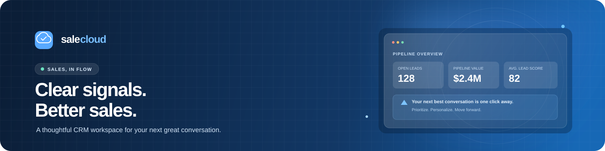

<div align="center">
  
  <br />
  <br />
  <a href="https://nodejs.org/"></a>
  <a href="https://expressjs.com/"></a>
  <a href="https://www.postgresql.org/"></a>
  
  <br />
  <p><strong>A thoughtful adoption workspace for turning first interest into lasting use.</strong></p>
  <p>Understand the task · Guide the trial · Capture what happens next</p>
</div>

## What is Salecloud?

Salecloud is a lightweight, Salesforce-inspired CRM for sales teams. It pairs an at-a-glance pipeline dashboard with a guided trial-adoption journal, so the team can understand what a user needs, support a real trial, and follow through on the outcome.

The hosted workspace is preloaded with fictional sample leads. Fresh installs start with an empty lead list so teams can add their own records. The sales brief uses lead scores and next steps to surface simple, explainable priorities; it does not call a generative AI service.

## Highlights

- **A clear sales overview** — open leads, estimated pipeline value, average lead score, and qualified leads.
- **Useful lead records** — contact details, source, owner, stage, estimated value, score, and next step.
- **Fast pipeline work** — search, stage tabs, owner filters, sorting, lead creation, status changes, and reversible archiving.
- **Prioritized follow-ups** — see suggested next steps for the highest-scoring leads.
- **Before the trial** — agree on the user task, input, expected result, current workaround, and a dated next step.
- **During the trial** — record completed steps, specific blockers, evidence, and whether hands-on help was needed.
- **After the trial** — capture the follow-up plan and whether the user expects to continue.
- **Product issue handoff** — save reproduction details and who will coordinate the fix.
- **Distinct adoption outcomes** — record interest, trial completion, repeat use, and paid as separate evidence-backed signals.
- **Portable data** — export the current lead view to CSV.
- **Team-ready access** — BoxLite organization access with platform-managed GitHub sign-in.
- **Persistent storage** — PostgreSQL-backed records managed through numbered migrations.

## Run it locally

You'll need Node.js 22+, npm, and a PostgreSQL database.

```sh
npm ci
createdb salecloud
psql "$DATABASE_URL" -f migrations/0001_init_leads.sql
npm start
```

Set `DATABASE_URL` to your PostgreSQL connection string before the migration and start commands. Copy [`.env.example`](.env.example) as a reference; the app reads its environment directly and does not load `.env` files itself.

Open [http://localhost:3000](http://localhost:3000). Sign-in is handled by BoxLite in the hosted deployment. For a local preview, requests to `/api` and `/app` must include the identity headers described in `server.js`, or you can adapt the `signedIn` middleware for a local-only development setup.

## Deploy on BoxLite

The app manifest and migration are in [`boxlite.toml`](boxlite.toml) and [`migrations/`](migrations/). The hosted service builds with `npm ci`, starts with `npm start`, and serves `/healthz` as its health check. Database schema changes should be added as a new numbered migration.

## Project layout

```text
server.js                 Express API and static app server
public/index.html         Sales workspace UI
public/app.js             Lead and trial-adoption interactions
public/assets/            Salecloud brand artwork
migrations/               PostgreSQL schema and trial activity
boxlite.toml              Hosted runtime, access, and auth settings
```

## License

No license has been added yet. Add one before granting reuse rights to others.
